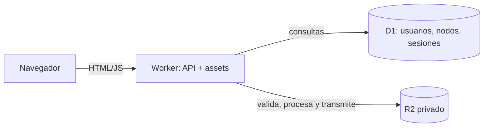

# vega-drive

# Vega Drive

Sistema de almacenamiento de archivos en la nube (tipo Drive / Mega) construido **100 % sobre Cloudflare**, sin Cloudflare Containers. Producto propio para un máximo de **10 clientes**, con aislamiento total entre cuentas: ningún cliente puede ver, editar ni eliminar los archivos de otro.

> Estado del proyecto: en planificación. Consulta el [roadmap](./roadmap.md) para las fases y el [Security](./Security.md) para las reglas de seguridad obligatorias.

---

## Características previstas

- Registro, login, página de inicio y dashboard.
- Carpetas y archivos por usuario (crear, renombrar, mover, eliminar, papelera).
- Subida y descarga de archivos exclusivamente mediante la API del Worker; el navegador nunca se conecta a R2.
- Descargas con soporte de `Range` (reanudación y streaming).
- Cuotas de almacenamiento por usuario.
- Enlaces compartidos con expiración (opcional, fase posterior).
- Sin cifrado de extremo a extremo (decisión de producto): los archivos se guardan cifrados en reposo por R2.

## Stack

| Necesidad | Servicio |
|---|---|
| Archivos | Cloudflare **R2** (acceso exclusivo del Worker/backend) |
| Metadatos, usuarios, sesiones | Cloudflare **D1** |
| Backend / API | Cloudflare **Workers** |
| Frontend | Workers con assets estáticos |
| Estado concurrente (cuotas, subidas) | **Durable Objects** (si hace falta) |
| Tareas programadas | **Cron Triggers** / **Queues** |
| Anti-bots | **Turnstile** |
| Límite de peticiones | **Workers Rate Limiting** |

Lenguaje: TypeScript. Librería de firma S3: [`aws4fetch`](https://github.com/mhart/aws4fetch).

## Arquitectura



Idea clave: **todo acceso a R2 pasa por el Worker**. El Worker autentica, autoriza, valida propiedad y cuota, y transmite los bytes entre el navegador y el bucket. El navegador no recibe URLs prefirmadas, ni conoce el endpoint de R2, ni usa credenciales, SDKs o APIs de S3.

### Flujo de subida

1. El navegador envía el archivo a `POST /api/files` del Worker, sin lógica de negocio ni comunicación con R2.
2. El Worker valida sesión, autorización, nombre, tipo, tamaño y cuota; crea internamente la clave `u/{userId}/{uuid}`.
3. El Worker transmite el contenido a R2 con sus bindings o credenciales privadas y verifica el tamaño real.
4. Solo tras completar la operación, el Worker registra el archivo en D1 y devuelve un resultado seguro al navegador.
5. Si falla, el Worker limpia los recursos internos; el navegador nunca opera subidas multipart ni claves de R2.

## Estructura del repositorio (propuesta)

```
vega-drive/
├─ README.md
├─ ROADMAP.md
├─ SECURITY.md
├─ wrangler.toml
├─ package.json
├─ tsconfig.json
├─ migrations/            # migraciones SQL de D1
├─ src/
│  ├─ index.ts            # entrada del Worker y router
│  ├─ routes/             # auth, folders, files, uploads, shares, admin
│  ├─ middleware/         # sesión, CSRF/Origin, rate limit, headers
│  └─ lib/                # crypto, sesiones, cliente S3, validación
├─ public/                # inicio, registro, login, dashboard
├─ tests/
└─ .github/workflows/     # CI
```

## Requisitos

- Cuenta de Cloudflare con R2 y D1 habilitados.
- Node.js LTS y `npm`.
- `wrangler` (`npm i -D wrangler`).
- Un dominio gestionado en Cloudflare (recomendado).

## Puesta en marcha

```bash
# 1. Dependencias
npm install

# 2. Autenticarse en Cloudflare
npx wrangler login

# 3. Crear recursos
npx wrangler r2 bucket create vega-drive-files
npx wrangler d1 create vega-drive-db

# 4. Copiar el database_id resultante a wrangler.toml

# 5. Aplicar migraciones
npx wrangler d1 migrations apply vega-drive-db --local   # desarrollo
npx wrangler d1 migrations apply vega-drive-db --remote  # producción

# 6. Secretos (nunca en el repositorio)
npx wrangler secret put R2_ACCESS_KEY_ID
npx wrangler secret put R2_SECRET_ACCESS_KEY
npx wrangler secret put CF_ACCOUNT_ID
npx wrangler secret put TURNSTILE_SECRET
npx wrangler secret put INVITE_SECRET

# 7. Desarrollo y despliegue
npx wrangler dev
npx wrangler deploy
```

### Aislamiento de R2

No se configura CORS para el navegador en el bucket R2: R2 no recibe peticiones desde el cliente. El bucket permanece privado y solo el Worker/backend utiliza sus bindings o credenciales privadas. Cualquier necesidad de descarga o subida se implementa como una ruta autenticada de `/api`.

## Variables y secretos

| Nombre | Tipo | Descripción |
|---|---|---|
| `R2_ACCESS_KEY_ID` | secreto | Credencial S3 de R2 (solo permisos sobre este bucket) |
| `R2_SECRET_ACCESS_KEY` | secreto | Clave secreta S3 de R2 |
| `CF_ACCOUNT_ID` | secreto | ID de la cuenta de Cloudflare |
| `BUCKET_NAME` | variable | Nombre del bucket |
| `TURNSTILE_SECRET` | secreto | Verificación de Turnstile |
| `INVITE_SECRET` | secreto | Firma de códigos de invitación |
| `MAX_USERS` | variable | Tope de cuentas (10) |

## Seguridad

Resumen de los principios (detalle completo en [SECURITY.md](./SECURITY.md)):

1. **Aislamiento por usuario en cada consulta y cada clave de R2.** El `userId` sale siempre de la sesión, nunca del cliente.
2. **Bucket privado.** Todo acceso a objetos es efectuado por el Worker/backend; no se emiten URLs prefirmadas al navegador.
3. **Registro cerrado** (invitación o tope de 10 usuarios).
4. **Secretos solo en `wrangler secret`**, jamás en el código ni en el repositorio.
5. **Cada implementación del roadmap debe cumplir el checklist de seguridad** antes de fusionarse.

## Contribución

- Trabaja en ramas `feature/<fase>-<descripcion>` y abre PR hacia `main`.
- Cada PR debe incluir el checklist de seguridad de [Security.md](./Security.md#checklist-de-pull-request) completado.
- Commits en formato convencional (`feat:`, `fix:`, `chore:`, `docs:`, `security:`).

## Licencia

Por definir (producto propietario).
